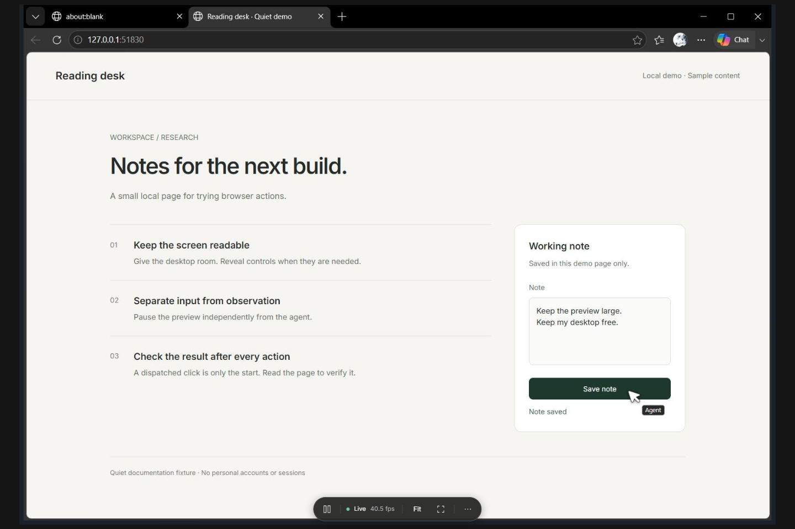
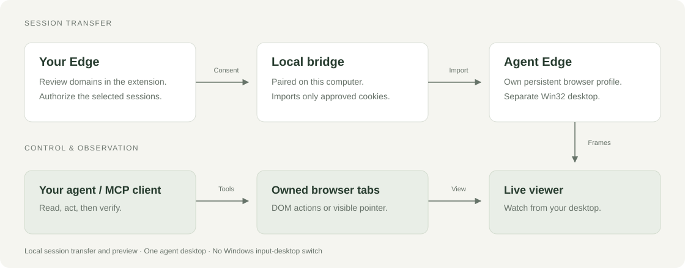
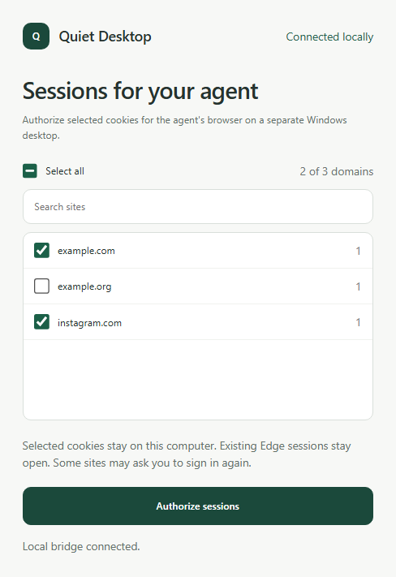
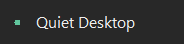
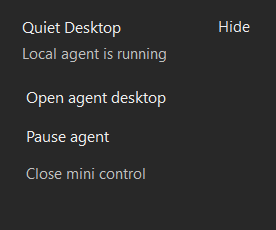
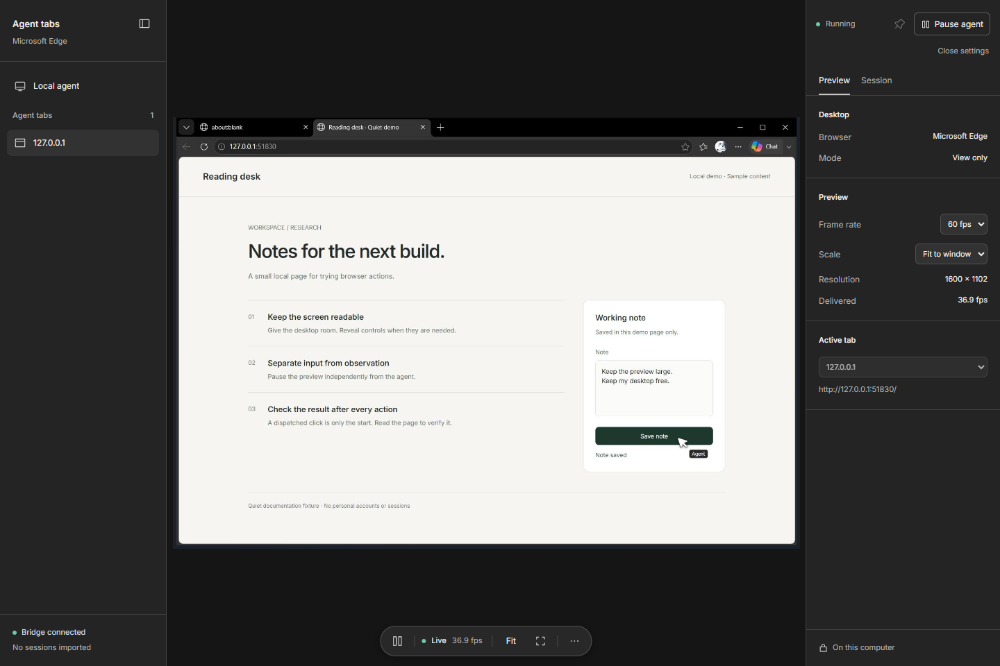

<div align="center">

# Quiet

Run a browser agent on a separate Windows desktop.

**Windows · Microsoft Edge · MCP**

[Get started](#get-started) · [How it works](#how-it-works) · [Agent tools](#connect-your-agent) · [Development](docs/development.md)

</div>



<p align="center"><sub>Actual viewer capture with a local demo page. All content is sample data.</sub></p>

Quiet gives an agent its own Edge window on a native Win32 desktop. Watch it work in a live preview while you keep using your normal desktop and mouse. Reuse selected browser sessions through an extension that asks for your approval.

This is an early Windows MVP. It provides tools for your existing agent client; it does not include a model or an autonomous agent loop.

## What it does

- **Separate workspace.** The agent's browser runs on another Win32 desktop in your Windows session. No VM.
- **Session consent.** Review domains, exclude sites, then authorize one local cookie transfer. Your source cookies stay unchanged.
- **Two ways to act.** Read and click page elements, or move a visible pointer and click by coordinates inside the page.
- **Small controls.** A movable mini control opens the viewer and pauses the agent. Preview panels stay closed until needed.

## How it works



Authorize sessions in your normal Edge profile. Quiet starts the agent browser with its own persistent profile and imports only the selected cookies. Your MCP client operates owned tabs; the local viewer streams the result.

A successful cookie import does not prove a site is signed in. Read the resulting page to verify authentication.

## Get started

You need **Windows, Microsoft Edge, Node.js 22+** and the Windows **.NET Framework C# compiler**. No administrator access, .NET SDK or model API key is required to run Quiet itself.

```powershell
git clone https://github.com/5forzin/quiet.git
cd quiet
.\Setup.cmd
```

Setup installs dependencies, builds the native desktop host, generates local pairing files and starts the bridge.

1. In the Edge profile with the sessions you want to share, open `edge://extensions`.
2. Enable **Developer mode**, select **Load unpacked**, and choose the project's `extension` folder.
3. Open **Quiet Desktop Session Bridge**. Review the selected domains and click **Authorize sessions**.
4. Run `.\Preview.cmd`, then click **Open agent desktop** in the mini control.

<details>
<summary><strong>What session authorization looks like</strong></summary>

<br>


The extension shows domain names and counts before authorization. This capture uses synthetic cookies, including a deliberately excluded domain. Cookie values are not displayed.

</details>

After restarting Windows, run `npm run start:background` before opening the preview. For terminal diagnostics, use `Start.cmd`. Quiet does not install a startup entry.

## Watch and control

Click the mini control to expand it. Drag the collapsed control to move it. Closing it leaves the agent running.

<table>
<tr><td align="center" width="240"><strong>Collapsed</strong></td><td align="center" width="320"><strong>Expanded</strong></td></tr>
<tr><td align="center"></td><td align="center"></td></tr>
</table>

The viewer offers Fit/100%, full screen, keep on top, preview pause and 30/60 fps targets. The counter reports frames actually presented; 60 fps is a target, not a guarantee.

Use **…** to open tabs, settings, session details or activity. Drag a panel's inner edge to resize it; widths persist locally. **Pause preview** stops the stream. **Pause agent** blocks browser mutations.

<details>
<summary><strong>Tabs and preview settings</strong></summary>

<br>



</details>

## Connect your agent

Add the generated **`mcp-config.local.json`** to your MCP client's configuration. It contains the correct executable and project paths for your installation. A portable example is available in [mcp-config.example.json](mcp-config.example.json).

Keep the bridge running. Start the preview service before using screenshot or pointer tools.

| Task | Tools |
| --- | --- |
| Open and close owned tabs | `quiet_open`, `quiet_close` |
| Read page text and element references | `quiet_read` |
| Act on elements | `quiet_click`, `quiet_fill`, `quiet_select` |
| Inspect the page and use its visible cursor | `quiet_view`, `quiet_pointer_move`, `quiet_pointer_click` |
| Verify an expected result | `quiet_wait` |
| Inspect or pause the agent | `quiet_status`, `quiet_pause`, `quiet_resume` |

Pointer coordinates are **CSS pixels in the page viewport**, excluding browser chrome. `quiet_view` returns viewport dimensions and a screenshot. Account for its device scale when selecting coordinates from the image. DOM clicks do not animate the pointer. Verify the result after either kind of click.

## Current boundaries

| Area | Current behavior |
| --- | --- |
| Agents | One native desktop and one agent browser, with multiple owned tabs. |
| Sessions | One-way cookie import. No localStorage, IndexedDB, passkeys, browser sign-in or partitioned cookies. Sites can require another sign-in or reject imported sessions. |
| Pointer | Works inside browser pages. No control of other Windows apps, browser chrome or native dialogs. |
| Isolation | A separate desktop separates windows; it is **not a filesystem or permissions sandbox**. |
| Data | Session transfer and preview stay local. Your MCP client determines where page text and screenshots are processed. |
| Distribution | Source build and manually loaded extension. No signed installer or extension-store listing. |

Local services bind to `127.0.0.1` and require pairing credentials. Browser profiles, tokens, generated configuration and private captures are excluded from this repository. [Architecture and data flow →](docs/architecture.md)

## Development

```powershell
npm test
npm run test:mini
npm run test:pointer
npx playwright install chromium
npm run test:integration
```

The native tests use temporary profiles and synthetic sessions in an interactive Windows session. CI runs unit tests and compiles the Windows hosts. [Build commands, test coverage and screenshot capture →](docs/development.md)

Stop the bridge and its owned browser with `node src/cli.mjs stop`. The agent profile persists for the next run.
